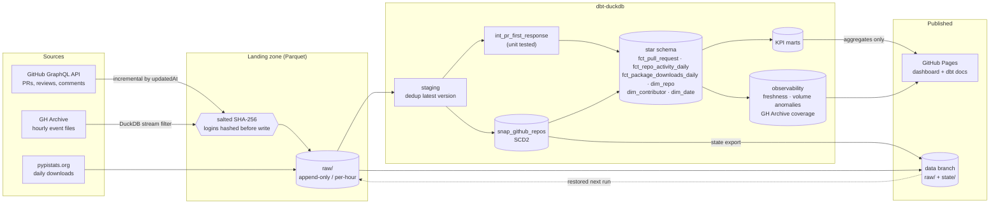

# OSS Pulse

[](https://github.com/duan-n2d/oss-pulse/actions/workflows/ci.yml)
[](https://github.com/duan-n2d/oss-pulse/actions/workflows/daily.yml)

**Live dashboard: https://duan-n2d.github.io/oss-pulse/** · [dbt docs](https://duan-n2d.github.io/oss-pulse/dbt-docs/)

How quickly do the open-source projects of the data ecosystem (Spark, Airflow, Polars,
Arrow, dbt, DuckDB, Iceberg, Flink, Delta, Dagster, Great Expectations, Splink,
Hugging Face Datasets) answer and merge pull requests, who carries the load, and is
adoption growing?

## Problem

A team that wants to sponsor, adopt or contribute to an open-source project needs to
know how healthy its review process is. A contributor wants to know whether a PR will
be looked at this week or this quarter. Star counts answer neither question. OSS
Pulse measures it from the projects' own activity:

* **Responsiveness**: time to first human review or comment, share left unanswered.
* **Outcomes**: merge rate, time to merge, newcomers versus maintainers.
* **Concentration**: how few people author or press merge on half of the work.
* **Adoption**: PyPI downloads and their trend.

It is an analytics-engineering and data-governance project on real data: incremental
ingestion from three public sources, a dbt star schema with contracts, SCD2, unit
tests and data tests, source freshness and volume monitoring, pseudonymisation at
the edge, and a daily GitHub Actions pipeline that deploys a static dashboard. It
costs nothing to run.

## Results

<!-- RESULTS:START -->
Run `oss-pulse report` after a build to fill this block.
<!-- RESULTS:END -->

The dashboard has the full picture, including response-time distributions, weekly
activity and data health. Numbers above are regenerated by `oss-pulse report` from
the warehouse; none are typed by hand.

## Architecture



A daily GitHub Actions job (03:30 UTC) restores the landing zone from the `data`
branch, ingests increments, runs `dbt build`, republishes the data branch and deploys
the site. CI runs lint, unit tests and two `dbt build`s (full, then incremental with
snapshot restore) on an offline fixture written through the real landing code.

## Quick start

```bash
python -m venv .venv && . .venv/bin/activate     # Windows: .venv\Scripts\activate
pip install -e ".[dev]"
make salt                     # creates .salt (git-ignored); export it as OSS_PULSE_SALT
export OSS_PULSE_SALT=$(cat .salt)

oss-pulse ingest-github       # GITHUB_TOKEN or `gh auth login`; first run backfills 365 days
oss-pulse ingest-gharchive    # yesterday, all 24 hours (or --date/--hours)
oss-pulse ingest-pypi
oss-pulse build               # dbt source freshness + dbt build
oss-pulse export-site && make docs
python -m http.server 8000 --directory site

oss-pulse locate https://github.com/pola-rs/polars/pull/30893   # one PR vs its repo
make fixture-build            # what CI runs: offline fixture, pinned as-of date
pytest -q
```

## Data model

| Model | Grain | Notes |
|---|---|---|
| `fct_pull_request` | PR | incremental on `updated_at`; first response, review, merge timings; size bucket |
| `fct_repo_activity_daily` | repo × day | PR flow from the API; GH Archive stars/forks/comments with hours loaded |
| `fct_package_downloads_daily` | package × day | PyPI without mirrors, 7-day average |
| `dim_repo` | repo | current attributes from the SCD2 snapshot, latest stars/forks, PyPI package |
| `dim_contributor` | person | pseudonymised key only; activity counts |
| `dim_date` | day | |
| `mart_repo_scorecard` | repo | window KPIs |
| `mart_response_time_distribution`, `mart_response_quantiles`, `mart_latency_by_contributor_type` | repo × bucket / type | dashboard |
| `obs_source_freshness`, `obs_volume_anomalies`, `obs_gharchive_coverage` | source / series × day | data health |

Every mart has an enforced contract. Tests include uniqueness, relationships, accepted
values, a governance test that every contributor key is a 16-hex hash, singular tests
for temporal consistency (nothing merged or answered before it was opened, no PR
"answered" by its own author) and a dbt unit test for the first-response rule.

## Design decisions

The short version (full reasoning in [docs/decisions.md](docs/decisions.md)):

* **The GitHub API, not GH Archive, is the source of truth for PRs.** GH Archive's
  volume collapsed in 2026 (see Results); a coverage monitor caught it, and GH Archive
  counts are now treated as a sample.
* **Landing is append-only or per-hour-overwrite, so every step is safe to rerun.**
* **State between Actions runs lives on a single-commit orphan `data` branch.** The
  warehouse is rebuilt each run; only SCD2 history is exported and restored.
* **Static site over exported JSON** instead of a BI tool: no server, and the export
  is an explicit list of what is published.

## Governance

Logins are hashed with a secret salt before anything is written, so the public data
branch and site carry no usernames; the site publishes aggregates only. Pseudonymised
data is still personal data under GDPR and Vietnam's personal data protection rules,
and PR numbers lead back to authors on GitHub, so the project limits purpose and
fields and publishes no person-level views. Details, controls and erasure:
[docs/governance.md](docs/governance.md). Operations: [docs/runbook.md](docs/runbook.md).

## Honest limits

* **First response** counts submitted reviews and top-level comments, the first ten of
  each. A maintainer who only leaves inline review comments without submitting a
  review is missed.
* **`contributor_type`** comes from GitHub's `authorAssociation` as reported at ingest
  time, not at PR creation, so some early PRs of now-regular contributors are labelled
  `returning_contributor` rather than `newcomer`.
* **GH Archive** stars, forks and comments are a partial sample since its 2026 volume
  drop, and before the daily job has run for a while only weekly sample hours exist.
* **The window is 365 days of PR creation**; bus factors and return rates say nothing
  about longer history.
* **The daily Actions job and Pages deployment** are defined but are verified only
  once they have run on GitHub; the local pipeline and the CI fixture build are
  verified.
* **PyPI downloads** exclude known mirrors but still include CI and other automated
  installs; they indicate adoption trends, not user counts.

## Stack

Python 3.11+ · DuckDB · dbt-core + dbt-duckdb · PyArrow · GitHub GraphQL API · GH
Archive · pypistats.org · Observable Plot · GitHub Actions · GitHub Pages · pytest ·
ruff.

## License

MIT
